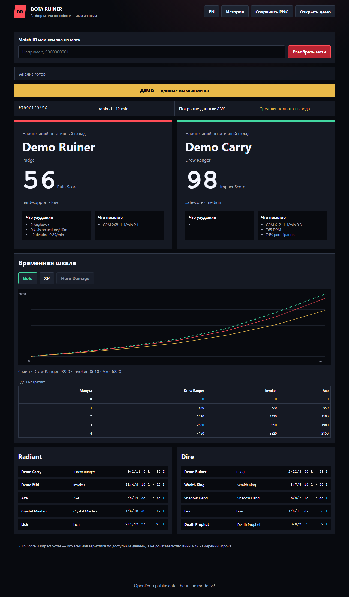

# DOTA RUINER

[](https://github.com/morphlxngg/dota-ruiner/actions/workflows/ci.yml)
[](https://morphlxngg.github.io/dota-ruiner/)
[](LICENSE)

Объяснимый разбор публичного матча Dota 2 по данным OpenDota. Приложение показывает отдельно Ruin Score и Impact Score, раскрывает использованные факторы и явно сообщает, когда данных для вердикта недостаточно.

> Оценки — детерминированная эвристика по доступным данным, а не доказательство вины, намерений игрока или причины поражения. Числовой «вероятности виновности» в проекте нет.

[Открыть GitHub Pages](https://morphlxngg.github.io/dota-ruiner/)



<details>
<summary>Мобильный интерфейс</summary>


</details>

## Что входит

- реальные `gold_t` и `xp_t` OpenDota; Hero Damage timeline отключён, если временного ряда нет;
- роли Safe Core / Mid / Offlane / Soft Support / Hard Support с видимой категорией определённости;
- версионированные `ruin-v2.0.0` и `impact-v2.0.0`, компоненты «что ухудшило» и «что помогло»;
- Steam `personaname`, если имя присутствует в ответе; безопасный fallback по герою без дополнительных запросов на деанонимизацию;
- история до 15 компактных анализов, сравнение двух последних матчей и экспорт PNG;
- RU/EN, адаптивный интерфейс, keyboard navigation, reduced motion и axe-проверки;
- PWA: офлайн открываются оболочка, явно помеченное вымышленное демо и уже сохранённый последний анализ;
- защищённый локальный OpenDota-прокси с TTL-кэшем, rate-limit, ограниченной очередью и graceful shutdown.

## Достоверность данных

Нормализатор сохраняет отсутствующие метрики как `null`; отсутствие не превращается в ноль и не штрафует игрока. Процент «Покрытие данных» означает только долю весов модели, для которых нашлись пригодные поля. Это не статистическая уверенность.

| Покрытие | Вывод |
| --- | --- |
| `< 50%` | основной вердикт скрыт |
| `50–69%` | низкое качество вывода |
| `70–84%` | среднее качество |
| `85–100%` | потенциально высокое; понижается при слабой роли или малом разрыве лидеров |

Матчи 9/11 игроков показываются с предупреждением. Матчи короче пяти минут, без двух команд или без двух пригодных игроков отклоняются контролируемо. Турбо использует отдельный профиль. Неполностью распарсенные матчи помечаются.

### Ruin Score v2

| Компонент | Вес | Наблюдаемая основа |
| --- | ---: | --- |
| Смерти | 25 | смерти/мин и относительно команды |
| Экономика | 20 | GPM и LH/мин относительно роли и режима |
| Урон | 20 | DPM относительно роли |
| Участие | 15 | `(kills + assists) / team kills` |
| Обязанности роли | 10 | вижен/стэки для поддержки или урон строениям для core |
| Macro | 10 | только наблюдаемый `buyback_count` |
| Abandon | до 20 | подтверждённый leaver/abandon; итог всегда ограничен 100 |

### Impact Score v2

Impact не равен `100 - Ruin`. Его веса: участие 25, вклад уроном/utility 25, экономика 15, объекты 15, обязанности роли 10, выживаемость 10.

Все веса и benchmarks находятся в [`src/data/scoring-config.js`](src/data/scoring-config.js). Формулы покрыты unit-тестами. Изменение формулы требует новой версии модели и миграционного пояснения — см. [CONTRIBUTING.md](CONTRIBUTING.md).

## Архитектура

```text
index.html                семантическая оболочка
src/api/                  ввод, OpenDota, отмена и last-request-wins
src/domain/               нормализация, роли, score и качество вывода
src/data/                 конфиг модели, герои, i18n, immutable demo
src/storage/              ограниченная localStorage-история
src/ui/                   безопасный DOM, график, сравнение, PNG
server.js + server/       локальный static/proxy server
tests/unit + tests/e2e    Vitest, Playwright, axe
public/                   manifest, service worker, icons, OG image
```

Vanilla JavaScript и ES-модули собираются Vite. Домен не зависит от DOM/сети. Рендер использует `textContent`/DOM API и не вставляет пользовательские строки через HTML.

## Локальный запуск

Требуется Node.js 22+.

```bash
npm ci
npm run dev
```

Команды одинаковы в PowerShell, Terminal.app и Linux shell. Vite открывается на адресе, который напечатает терминал.

Production-like запуск с локальным прокси:

```bash
cp .env.example .env       # PowerShell: Copy-Item .env.example .env
npm run build
npm start                  # http://127.0.0.1:4174
```

Переменные:

| Имя | По умолчанию | Назначение |
| --- | --- | --- |
| `OPENDOTA_API_KEY` | пусто | необязательный серверный ключ OpenDota |
| `HOST` | `127.0.0.1` | адрес локального сервера |
| `PORT` | `4174` | порт |

Ключ читается только Node-сервером. Браузерный `?api_key=` запрещён, ключ не попадает в клиентский bundle, storage, ответы и логи. Не коммитьте `.env`.

## GitHub Pages и API

Workflow собирает `dist` с base path репозитория и публикует его как Pages artifact. Node.js на GitHub Pages не запускается, поэтому Pages обращается к публичному OpenDota API без ключа. Локальный `/api/matches/:id` существует только при `npm start`. Лимиты или CORS публичного API отображаются как ошибка и никогда не подменяются демо-данными.

## PWA и приватность

Service worker кэширует только собранную оболочку. История хранит до 15 версионированных компактных snapshots и downsampled timeline, примерно до 2.5 МБ; raw API-ответы и ключи не сохраняются. Ошибки quota/corrupt JSON не ломают текущий анализ. Демо вымышлено, неизменно, помечено `ДЕМО / DEMO` и не входит в историю реальных матчей.

## Команды

```bash
npm test             # Vitest
npm run test:e2e     # desktop + mobile Playwright, включая axe
npm run build        # production dist
npm run check        # полный release gate
npm run screenshots  # переснять детерминированное demo desktop/mobile
```

## Проверка релиза

Автоматически проверяются нормализация, роли, обе модели, отсутствие штрафа за missing data, API errors, гонки запросов, XSS-safe rendering, история, сравнение, PNG, реальные timeline, offline PWA, desktop/mobile critical flow, axe serious/critical, keyboard activation, target size и reduced motion.

Перед выпуском дополнительно проверяются 200% zoom, Windows High Contrast, офлайн-метка демо, завершение локального сервера и поиск случайно добавленных секретов. Автоматизированный axe-аудит покрывает только часть WCAG и не является заявлением о полной сертификации WCAG.

## Лицензия и вклад

MIT — см. [LICENSE](LICENSE). Предложения по метрикам и весам приветствуются, если они основаны на реально доступных полях OpenDota и сопровождаются fixtures, тестами и новой версией модели при изменении смысла score.
